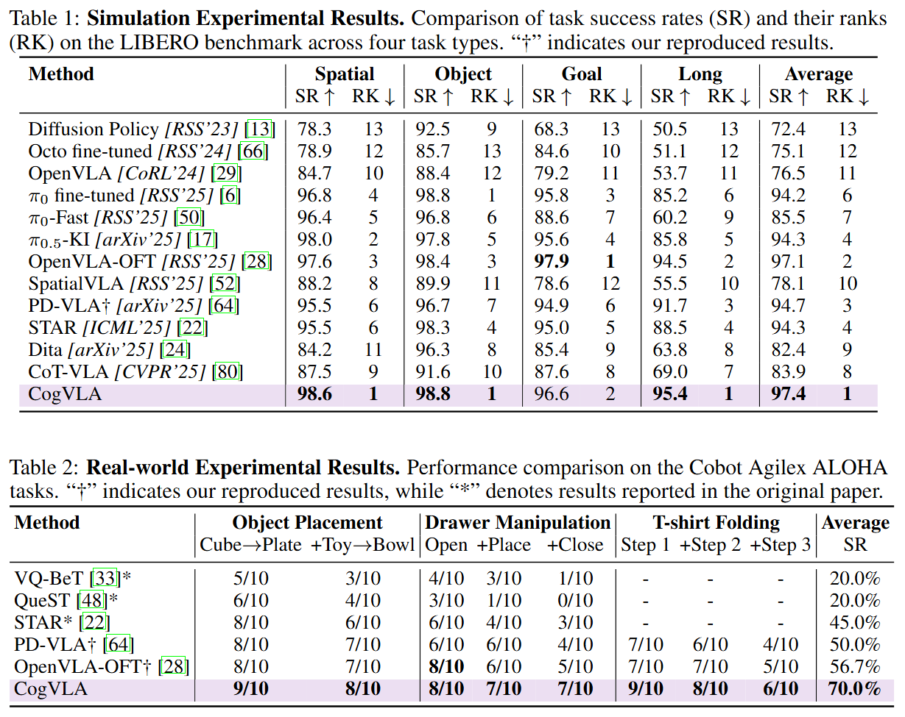

<div align="center">

<!-- <h1>JiuTian (九天) </h1> -->
<h2 class="papername">  CogVLA: Cognition-Aligned Vision-Language-Action Models via Instruction-Driven Routing &amp; Sparsification<br>NeurIPS 2025</h2>
<div>
<div>
    <a href="https://orcid.org/0009-0007-7675-3550" target="_blank">Wei Li</a>,
    <a href="https://scholar.google.com/citations?user=iMJYtvwAAAAJ" target="_blank">Renshan Zhang</a>,
    <a href="https://rshaojimmy.github.io/OrionLab/" target="_blank">Rui Shao*</a>,
    <a href="https://orcid.org/0009-0001-9102-7051" target="_blank">Jie He</a>,
    <a href="https://liqiangnie.github.io/index.html" target="_blank">Liqiang Nie</a>
</div>

School of Computer Science and Technology, Harbin Institute of Technology, Shenzhen<br>
*Corresponding author

[](https://arxiv.org/abs/2508.21046)
[](https://jiutian-vl.github.io/CogVLA-page/)
[](https://www.star-history.com/#JiuTian-VL/CogVLA)

<h3 align="center">
<strong>
🔥CogVLA is accepted to NeurIPS 2025!🔥
<br>
⭐ Give us a star if you like it! ⭐
<br>
✨If you find this work useful for your research, please kindly cite our paper.✨
</strong>
</h3>


</div>
</div>


## :fire: Updates

- [06/2026] :fire: Updated the representative issue and checkpoints.
- [09/2025] :fire: Code released. Enjoy it!
- [09/2025] :fire: CogVLA is accepted to **NeurIPS 2025**!
- [08/2025] :fire: [Project page](https://jiutian-vl.github.io/CogVLA-page/) released.
- [08/2025] :fire: [arXiv paper](https://arxiv.org/abs/2508.21046) released.

## Introduction

This is the github repository of *CogVLA: Cognition-Aligned Vision-Language-Action Models via Instruction-Driven Routing \& Sparsification*. CogVLA draws inspiration from human multimodal coordination and introduces a 3-stage progressive architecture. 

Extensive experiments on the LIBERO benchmark and real-world robotic tasks demonstrate that CogVLA achieves state-of-the-art performance with success rates of 97.4\% and 70.0\%, respectively, while reducing training costs by 2.5× and decreasing inference latency by 2.8× compared to OpenVLA.

<div align="center">

</div>

The overall framework of CogVLA is illustrated below.

<div align="center">

</div>


## Installation

```bash
# Create and activate conda environment
conda create -n cogvla python=3.10 -y
conda activate cogvla

# Clone CogVLA repo and pip install to download dependencies
git clone git@github.com:JiuTian-VL/CogVLA.git
cd CogVLA
pip install -e .

# Install Flash Attention 2 for training
pip install packaging ninja
ninja --version; echo $?  # Verify Ninja --> should return exit code "0"
pip install "flash-attn==2.5.5" --no-build-isolation
```


## Training and Evaluation

See [LIBERO.md](docs/LIBERO.md) for fine-tuning/evaluating on LIBERO simulation benchmark task suites.

See [ALOHA.md](docs/ALOHA.md) for fine-tuning/evaluating on real-world ALOHA robot tasks.

## Demos

After training, fill your checkpoint path in `demo.py`. Then run the following command

```bash
CUDA_VISIBLE_DEVICES=0 python demo.py
```


## Experiments

**Performance.** CogVLA achieves state-of-the-art performance with success rates of 97.4\% and 70.0\% on simulation and real-world tasks, respectively.

<div align="center">

</div>

**Efficiency.** CogVLA also reduces training costs by 2.5× and decreases inference latency by 2.8× compared to OpenVLA.

<div align="center">

</div>

## Visualization

The attention maps of CogVLA highlight task-relevant regions in the input image, well aligning with human cognition during task execution.

<div align="center">

</div>

https://github.com/user-attachments/assets/31a3616d-eecf-47e6-8bf6-cc5471dc1de4

https://github.com/user-attachments/assets/67629cab-1175-40be-9250-7591d9b2b65c

## Representative Issue

Based on the following representative issue reported by the community, we analyze the potential sources of performance variability observed during CogVLA reproduction:

> "Hello, this is excellent work, and I greatly appreciate your contributions to the field of embodied intelligence. However, when reproducing the paper, I found that during evaluation in the LIBERO simulation environment, certain task suites (particularly Spatial and Long) failed to achieve the performance reported in the paper. For each task suite, I followed the instructions in LIBERO.md and modified the parameters in `finetune.sh` accordingly, fine-tuning each model for 80,005 steps. I then merged the weights and evaluated the resulting policy on the same device/GPU used for training. The reproduction results are as follows:
>
> * LIBERO-Spatial: 91.6%
> * LIBERO-Object: 98.2%
> * LIBERO-Goal: 96.6%
> * LIBERO-Long: 89.2%
>
> Reported results in the paper:
>
> * LIBERO-Spatial: 98.6%
> * LIBERO-Object: 98.8%
> * LIBERO-Goal: 96.6%
> * LIBERO-Long: 95.4%"

The reproduced average success rate is approximately 3.5% lower than that reported in the paper. To address this discrepancy, we recommend first considering the following factors:

**(1)**
As described in Appendix A, our models were trained for up to 60k steps. During training, we evaluated the model every 10k steps and ultimately reported the performance of the best-performing checkpoint rather than the final checkpoint. Consequently, the optimal performance may not necessarily correspond to the last training iteration (e.g., 80k steps), and evaluating only the final checkpoint may lead to suboptimal results.

**(2)**
In addition to training each LIBERO subset independently, we recommend performing joint training across all four LIBERO subsets. Following the same evaluation protocol described in (1), the best-performing checkpoint can then be selected from multiple evaluation stages. In our experience, joint training often provides a stronger and more stable optimization signal while significantly reducing overall training cost.

**(3)**
We observed that LIBERO evaluations exhibit non-negligible performance variance across different training runs, random seeds, and evaluation settings, particularly for aggressively compressed VLA architectures. Our observations indicate that such variance tends to become further amplified when the input representation is aggressively compressed. As a result, small differences in training dynamics, hardware configurations, numerical precision, or evaluation seeds can produce noticeable fluctuations in the final success rate.

> (1) "Following your suggestion, I evaluated checkpoints every 10k steps from 40k to 80k. However, the best results I obtained were still:
>
> * LIBERO-Spatial: 92.8%
> * LIBERO-Object: 98.4%
> * LIBERO-Goal: 96.6%
> * LIBERO-Long: 90.4%
>
> The Spatial and Long results remain significantly below those reported in the paper. What could be the reason?"
>
> (2) "Are the results reported in the paper obtained using joint training across all four subsets?"
>
> (3) "How can I mitigate the high variance of LIBERO? If the performance degradation originates from the simulation environment, does this imply that the method itself lacks robustness?"

The reproduced average success rate in this case remains approximately 2.9% below our reported result. Based on our internal experiments, we provide the following detailed observations and practical recommendations (based on our previous experimental observations, the optimal checkpoint may vary across training runs). Relevant checkpoints will be released once the ongoing training runs are completed.

**(1)**
For the Spatial subset, we trained the model using 4 × A800 (80GB) GPUs following the configuration described in Appendix A. We obtained success rates of 98.4% and 98.6% at the 40k and 50k checkpoints, respectively. In contrast, later checkpoints achieved only 97.6% and 97.8%, suggesting that optimal performance occurs within a specific training window rather than monotonically improving with additional optimization steps.

We also observed considerable sensitivity to random seeds. For example, changing the seed from 7 to 42 resulted in approximately 1.2% performance variation. Moreover, even under identical seeds, repeated evaluations may still yield slightly different success rates, as observed on LIBERO-Goal.

**(2)**
For the Object subset, the best-performing checkpoint was obtained at 30k steps, achieving 98.8% success rate.

**(3)**
For the Goal subset, we obtained 96.6% success rate at the 40k checkpoint. However, under the same random seed and training configuration, we have also observed evaluation results as low as 95.0%.

**(4)**
For the Long subset, we experimented with both independent training and joint training. The most effective training strategy was found to be:

* Linear warmup: 2k steps
* Initial learning rate: 5e-4
* Cosine decay to 1e-8 over 80k steps

Using this schedule, we achieved 95.4% success rate at the 60k checkpoint. We note that this optimization strategy may also benefit the other LIBERO subsets.

**(5)**
After conducting extensive experiments across all subsets, we found that joint training provides a substantially more efficient training paradigm. Within a total training budget of fewer than 80k steps, all four subsets can already approach their respective optimal performance levels, reducing overall training cost by approximately 4× compared to training each subset separately. While performance fluctuations remain unavoidable, joint training generally produces optimal or near-optimal results.

**(6)**
We acknowledge that one limitation of CogVLA is that some degree of performance variation is unavoidable. For this reason, Appendix A explicitly states that evaluations are conducted every 10k steps and that the best-performing checkpoint is reported.

Our analysis suggests that this phenomenon is closely related to the routing mechanisms employed by CogVLA. Specifically:

* EFA-Routing aggregates visual tokens conditioned on task instructions during visual encoding.
* LFP-Routing further prunes visual tokens inside the language model according to task relevance.

Ultimately, only approximately 1/8 of the original visual tokens are retained, representing an intentional trade-off between computational efficiency and robustness.

During token pruning, some router scores may lie extremely close to the pruning threshold. Under such circumstances, minor numerical differences introduced by random seeds, GPU architectures, BF16 rounding behavior, attention kernel implementations, or low-level CUDA operations may alter whether a token is retained or discarded. For example, a routing score of 0.50001 may be retained, whereas 0.49999 may be pruned. Although the numerical difference is negligible, the resulting token set may differ, potentially propagating through the model and causing measurable variations in final task success rates. Therefore, they reflect the increased sensitivity that naturally arises in aggressively sparsified VLA architectures, where small perturbations in routing decisions can lead to amplified downstream effects during long-horizon embodied decision-making.

> This is my personal contact information: WeChat **runtolake**. 
>
> We are committed to continuously maintaining and improving this project, as well as providing more comprehensive open-source resources in future releases. If you are interested in this work, we would be very happy to stay in touch, discuss potential improvements, and work together with the community to further advance and refine the project.


## Update

We evaluate the performance of CogVLA on the LIBERO benchmark using our available compute resources (8×96GB RTX Pro 6000 GPUs). We adopt a batch size of 64, and each training run of 80K steps takes approximately 32 hours. We release the following checkpoints:

* LIBERO Spatial: https://huggingface.co/liwei2013/cogvla_libero_spatial_60000_chkpt
* LIBERO Object: https://huggingface.co/liwei2013/cogvla_libero_object_70000_chkpt
* LIBERO Goal: https://huggingface.co/liwei2013/cogvla_libero_goal_30000_chkpt
* LIBERO Long: https://huggingface.co/liwei2013/cogvla_libero_long_70000_chkpt 

For each task suite, we select the checkpoint corresponding to its best-performing training step and report results averaged over 3 evaluation runs. The success rates (mean ± standard deviation) across the four task suites are 98.5±0.1, 98.6±0.2, 97.7±0.3, and 95.0±0.6, respectively.

Notably, we observe that the MuJoCo version has a significant impact on LIBERO evaluation results. For instance, on LIBERO Spatial, success rates vary from approximately 97.8, 98.6, to 95.0 under MuJoCo v2.3.7, v3.3.6, and the latest release, respectively. LIBERO Long tends to favor the older MuJoCo version (v2.3.7), which yields improvements of approximately 1-2 percentage points over newer versions.

We hypothesize that this variance may stem from: (1) discrepancies between the MuJoCo rendering environment used during LIBERO data collection and current simulation engines, (2) stochasticity introduced by token compression and pruning mechanisms in CogVLA, and (3) differences in model robustness under varying rendering and physics implementations. Therefore, we recommend evaluating across multiple MuJoCo versions for more reliable benchmarking.

In addition, we conduct preliminary experiments on modified training configurations. Increasing LoRA rank to r=64 with α=128 and scaling the batch size to 128 consistently leads to more stable and improved performance on LIBERO Spatial and LIBERO Long in later training stages. When additional computational resources become available, we plan to further explore optimized training configurations for CogVLA.


## :fire: Citation

If you find this work useful for your research, please kindly cite our paper.

```
@article{li2025cogvla,
  title={CogVLA: Cognition-Aligned Vision-Language-Action Model via Instruction-Driven Routing \& Sparsification},
  author={Li, Wei and Zhang, Renshan and Shao, Rui and He, Jie and Nie, Liqiang},
  journal={Advances in neural information processing systems},
  year={2025}
}
```


